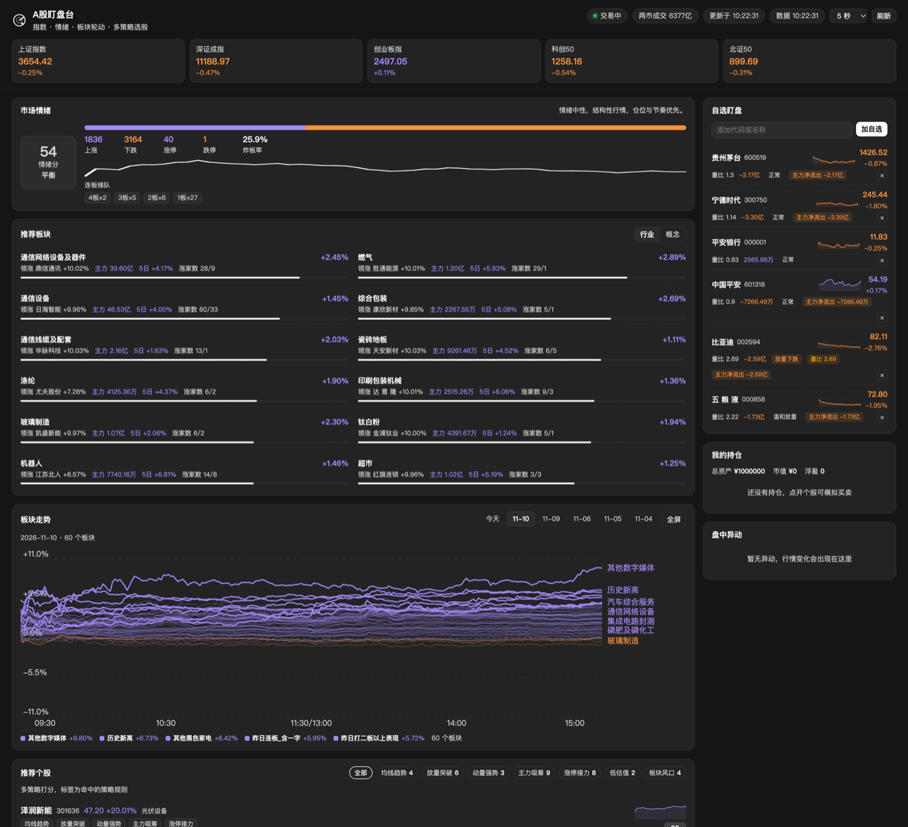
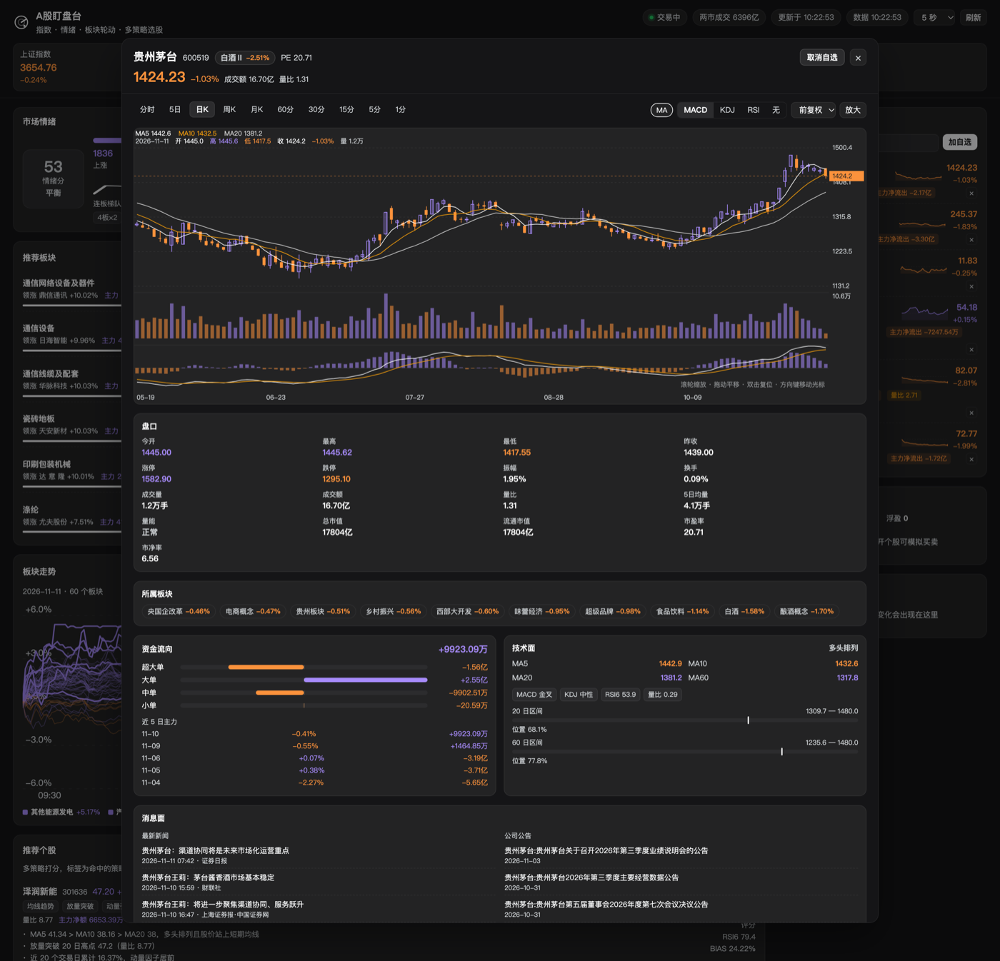

# A-share radar

A DeepSeek Harness plugin that turns the Web UI into a real-time A-share trading
desk: one sidebar entry opens a full page with the index tape, market breadth,
the limit-up ladder, sector rotation, scored stock picks, a watchlist and an
intraday alert feed. The same engine is exposed to the Agent as the
`ashare_radar` tool.

**English** · [简体中文](./README.zh-CN.md)

**Install with one command:**

```
plugin_manager  install_bundle  target=github:yg-y/ai-monitoring-stocks
```

You can also grab the tarball from
[Releases](https://github.com/yg-y/ai-monitoring-stocks/releases), or follow the
other two routes in [INSTALL.md](./INSTALL.md).

## Screenshots



*Index tape, market breadth, sector rotation, watchlist and the top-50 sector trend — captured live during the session.*



*Stock detail: daily candles with volume and MACD, order book, boards, money flow, technicals and news.*

## What it shows

| Block | Content | Refresh |
| --- | --- | --- |
| Index tape | SSE / SZSE / ChiNext / STAR 50 / BSE 50; click any index for its intraday chart and K-lines | 3–30 s (selectable) |
| Market sentiment | Advancers / decliners, limit-up / limit-down, broken-board rate, consecutive-board ladder, 0–100 sentiment score | 5 s |
| Top sectors | Industry and concept boards scored on change + main-force net inflow + breadth + 5-day momentum; click for constituents | 20 s |
| Sector trend | Intraday change curves for the top 50 boards (09:30–15:00) with end labels; replay any of the last 30 sessions | 60 s |
| Stock picks | Candidate pool → multi-strategy scoring → technical confirmation, with hit tags and reasons | 45 s |
| Watchlist | Live price, change, volume ratio, main-force net, hit signals; search by code or name | 3–30 s |
| Positions | Paper-account total, market value, unrealised P&L; click a position to reopen the stock | with snapshot |
| Alerts | Limit-up, approaching limit, speed, volume ratio, main-force moves, MA crosses, 20-day high | with snapshot |
| Stock detail | Open from the watchlist or the picks: intraday / 5-day / daily / weekly / monthly / 60–1 min K, crosshair, zoom & pan, MA + MACD/KDJ/RSI, adjustment, paper trading | 5 s while trading |

## Detail page

Opening a stock (or an index) gives a quote page, not just a chart:

| Block | Content |
| --- | --- |
| Order book | Open / high / low / prev close / limit-up / limit-down / amplitude / turnover rate / volume / amount / volume ratio / 5-day average volume / market cap / float cap / P/E (shows "亏损" when loss-making) / P/B |
| Money flow | Main-force net plus super-large / large / medium / small order nets (centred two-way bars), today's cumulative main-force curve, last 5 sessions' net and daily change |
| Technicals | MA5/10/20/60 and their alignment, MACD / KDJ / RSI state, position inside the 20- and 60-day range |
| Boards | Industry tags (clickable) followed by theme-first board tags; style and index boards come last |
| News | 8 latest stories + 6 company announcements with time and source; click a tag to open the original |
| AI analysis | Six-dimension upside analysis over the same numbers (technicals / volume / money flow / sector & sentiment / news / valuation), each 0-100 with a stance, reasons and risks, plus a verdict, confidence and support/resistance targets; multi-turn follow-ups |
| Chart | Intraday / 5-day / daily / weekly / monthly / 60–1 min K with crosshair, zoom and pan |

Data: quotes and K-lines come from Eastmoney, money flow from its `fflow`
endpoint (intraday cumulative + historical daily), board membership from
`slist`, news and announcements from its search and announcement endpoints.
Technical indicators are computed locally from daily bars (MA / RSI / MACD /
KDJ / range position).

## Performance & resilience

- **Two K-line sources**: Eastmoney's history host is primary; on failure or an
  empty reply the plugin switches to Tencent's public K-line API (daily / weekly
  / monthly + 1/5/15/30/60-minute, with forward and backward adjustment), so
  indicators recover with the chart.
- **K-lines cached on disk**: successful responses are stored under
  `<DSH_HOME>/ashare-radar/klines/`; when both sources are unreachable the last
  copy is replayed and the chart is labelled "showing the last cached candles".
- **Quote-host fallback**: when `push2` is throttled or down the plugin moves to
  `push2delay` (delayed quotes) and trips a 60-second breaker so requests stop
  paying the failed attempt first. Board constituents, indices, watchlist quotes
  and intraday charts all take this path.
- **Sector-trend fetch depth**: once the previous session is stored, a refresh
  pulls one day instead of five (`fetchDays: 1` in the response), cutting
  upstream bytes by 5×.
- **K-lines no longer punch through the cache every 5 s**: the chart polls every
  5 s but bars are only refetched when the cached copy is older than 30 s; the
  forming bar is patched client-side from the latest price.
- **Chart geometry is memoised**: 50 curves × 241 points ≈ 12k path segments are
  rebuilt only when the data changes; moving the pointer redraws just the
  crosshair.
- **The trend card waits for the viewport**: the first paint no longer pays 50
  upstream calls for the lower half of the page (`IntersectionObserver` with a
  240px prefetch margin).
- **Empty boards explain themselves**: a computed board with no constituents
  says so instead of showing a generic error.

Current 30-day storage footprint: 60 boards × 5 sessions ≈ 790 KB, roughly 4–5 MB
once the full 30 days are filled.

## Sector trend

The trend card plots each board's change against the previous close: the X axis is
fixed to the trading session (09:30–11:30, 13:00–15:00) and the Y axis is
symmetric around zero.

- Draws the **top 50 boards** in one pass (industry + concept merged and ranked by
  the day's change); the leading 8 are drawn bolder
- **Board names are printed at the end of each curve**; overlapping labels are
  skipped (at most 12)
- **Entry animation**: the curves are wiped in from the zero axis at x=0 to the end
  of the X axis (820ms clip reveal); it replays on entry, on a date switch and
  when the fullscreen view opens, but never on a poll refresh
- Line colour follows the day's direction — **purple for up, orange for down**,
  dimmed to 0.3 opacity so 50 lines stay readable

Data and storage:

- Source: Eastmoney board intraday (`secid=90.BKxxxx`), five sessions per call,
  each day re-based on the previous day's close
- Storage: `<DSH_HOME>/ashare-radar/sectors/YYYY-MM-DD.json`, one file per
  session, **kept for 30 days**, expired files pruned on every write
- At most 60 boards per day (the panel rotates which boards it views, so files
  cannot grow without bound); finished sessions with all 241 minutes are never
  rewritten
- Opening a session backfills the previous four, so a fresh install already has
  five days to browse
- The date buttons list stored sessions only; switching reads from disk and makes
  no upstream request

## AI analysis

The detail page ends with an **AI analysis** panel. It sends the same numbers the
page draws — quote, volume, size, moving averages, range, MACD/KDJ/RSI, volume
state, the four money-flow buckets, boards, market sentiment, news and
announcements — as a compact brief to the Host's `llm` service, using the
profile's default model.

- Six dimensions: technicals / volume / money flow / sector & sentiment / news /
  valuation, each with a 0-100 score and a bullish / neutral / bearish stance
- The system prompt requires citing only the brief's numbers, saying "数据不足"
  when something is missing, and never inventing financials or policy
- Output is strict JSON parsed by the Host and sent as `done.parsed`; the panel
  renders it as dimension cards
- If the output is cut off by the token limit, the parser falls back to the last
  complete structure and still renders finished dimensions; only a totally
  unparseable response falls back to a raw block with a retry hint
- Follow-ups are supported (multi-turn) and re-inject the latest data; answers
  are plain text
- The response is an NDJSON stream (`delta` / `meta` / `error` / `done`), rendered
  as it generates
- The POST route goes through the Host's request gate: only the signed-in local
  page can call it, so arbitrary local processes cannot spend model quota

## Drill-downs

- **Index → chart**: click any index for the same intraday / daily / weekly /
  monthly charts as a stock (indices have no trading panel)
- **Board → constituents**: click an industry or concept board for its
  constituents, sortable by change / main force / volume ratio / turnover /
  speed / market cap; click a row for that stock's chart
- **Stock → position**: a fill appears immediately in "Positions" with cost,
  last price and unrealised P&L; click it to reopen the stock

## Review notes

Deliberate choices that came out of the professional pass:

- Polling adapts to the session: the selected cadence while trading (5 s by
  default), automatically ≥30 s when closed
- The header shows **quote time**, not backend latency; indices are addressed by
  secid so "上证指数 000001" and "平安银行 000001" never collide
- Prices use two decimals, **purple for up and orange for down**, figures in
  tabular numerals
- Picks are de-duplicated by strategy family before scoring fills the list, so
  you never get eight copies of the same momentum rule; scores carry their rubric
- "Sell" is disabled without a position; index detail has no trading panel

## Chart conventions

The detail chart follows the layout and interaction rules A-share desks expect:

- **Periods**: intraday, 5-day intraday, daily, weekly, monthly, 60/30/15/5/1
  minutes
- **Main pane**: candlesticks (hollow up, solid down) or the intraday line; MA
  5/10/20 overlays, toggleable
- **Sub panes**: volume + MACD / KDJ / RSI (switchable to none)
- **Intraday**: price axis symmetric around the previous close, average line,
  dashed previous close, dashed limit-up / limit-down (10% main board, 20%
  ChiNext/STAR, 30% BSE, 5% ST)
- **Crosshair**: snaps to the nearest bar, follows the pointer with
  date/open/high/low/close/change/volume, and labels the price on the right and
  the date at the bottom
- **Interaction**: wheel zoom anchored at the pointer, drag to pan, double-click
  to reset, arrow keys to move the cursor, `+`/`-` to zoom, `0` to reset
- **Adjustment**: forward / none / backward
- **Live**: refreshed every 5 s while trading; the forming bar's high/low/close
  follow the latest price
- **Fullscreen**: one click expands the dialog to near full screen
- **Row sparklines**: every watchlist, pick and constituent row carries a 24px
  intraday sparkline (purple/orange, dashed previous close) plus "急拉" /
  "急跌" badges when a sharp move happens within 5 minutes (threshold scaled to
  the price limit, and only the last 40 minutes count)

## Strategy families

Each stock is scored by the rules below; tags name the rules that fired.

| Tag | Family | Rule |
| --- | --- | --- |
| 均线趋势 | Trend following | MA5 > MA10 > MA20 bullish alignment, price above MA5, MA20 turning up |
| 放量突破 | Volume/price pattern | Bullish break of a 20-day high with volume ratio ≥ 1.5 |
| 动量强势 | Momentum | 20-day gain ≥ 15% |
| 主力吸筹 | Money flow | Main-force net inflow / turnover ≥ 5% |
| 超跌反弹 | Mean reversion | 20-day deviation ≤ -8% and RSI6 ≤ 34 |
| 涨停接力 | Sentiment | Limit-up or approaching it (9.6% main board, 19.4% ChiNext/STAR) |
| 低估值 | Value | P/E ≤ 18, P/B ≤ 2, market cap ≥ ¥10bn, plus trend confirmation |
| 板块风口 | Rotation | The stock's industry ranks near the top of the day's board table |

Scores are a soft-capped sum of the rule weights, so a name that fires five rules
separates from one that fires two instead of both saturating.

## Data

Public, keyless, read-only feeds:

- Eastmoney quotes `push2.eastmoney.com` — indices, stocks, boards, K-lines
- Eastmoney limit pools `push2ex.eastmoney.com` — limit-up / limit-down / broken
  boards, consecutive-board counts, sealing orders
- Xueqiu breadth `flash-api.xuangubao.cn` — advancers / decliners / limit-up
  counts
- Tencent K-lines `web.ifzq.gtimg.cn` — daily/weekly/monthly and minute bars,
  used only as the fallback

The Host half caches each feed (quotes 2.5 s, boards 20 s, K-lines 4 min) and
falls back to the last good value when an upstream errors; failed sources are
reported in the panel instead of blanking it.

## Host surface

Read-only HTTP routes on the same origin as the Web UI:

- `GET /ashare-radar/api/snapshot?codes=600519,000001&mode=full|light&limit=8`
- `GET /ashare-radar/api/quote?codes=...`
- `GET /ashare-radar/api/sector?kind=industry|concept`
- `GET /ashare-radar/api/search?q=宁德`
- `GET /ashare-radar/api/detail?code=600519&period=trend|trend5|day|week|month|m60|m30|m15|m5|m1&adjust=0|1|2&fresh=0|1` — intraday (with limit prices) or K-lines, plus a snapshot
- `GET /ashare-radar/api/sector-trend?date=2026-11-10&codes=BK0459,BK1340` — board curves for one session (with a 30-day date index)
- `GET /ashare-radar/api/board?code=BK0459&sort=f3|f62|f10|f8|f22|f20&limit=50` — board constituents
- `GET /ashare-radar/api/flow?code=600519[&secid=1.000001]` — today's intraday money flow plus 5 sessions
- `GET /ashare-radar/api/news?code=600519&name=贵州茅台` — news and announcements
- `POST /ashare-radar/api/analyze` — AI analysis (NDJSON stream), body `{code,name,question?,history?}`
- `GET /ashare-radar/api/strategies`

Agent tool `ashare_radar`:

```
action: overview | quote | recommend | strategy | board | analyze
codes?: ["600519"]   limit?: 8
```

## Notes

- Outside the session the last quote still shows; the market phase (pre-open /
  auction / trading / lunch break / closed / weekend) is computed for
  Asia/Shanghai
- There is no holiday calendar: when upstream has no prints the page shows the
  last close
- The watchlist, refresh cadence and paper account live in browser
  `localStorage` (`ashare-radar.watchlist.v1`, `ashare-radar.speed.v1`,
  `ashare-radar.account.v1`)
- **Trading is a paper account**: fills are booked locally at the last price
  (¥1,000,000 start, 100-share lots); no broker, no real orders
- Strategy signals describe rule hits only and are **not investment advice**

## License

MIT — see [LICENSE](./LICENSE). Market data comes from public endpoints of
Eastmoney, Tencent and Xueqiu; the plugin is for personal research and is not
investment advice.
