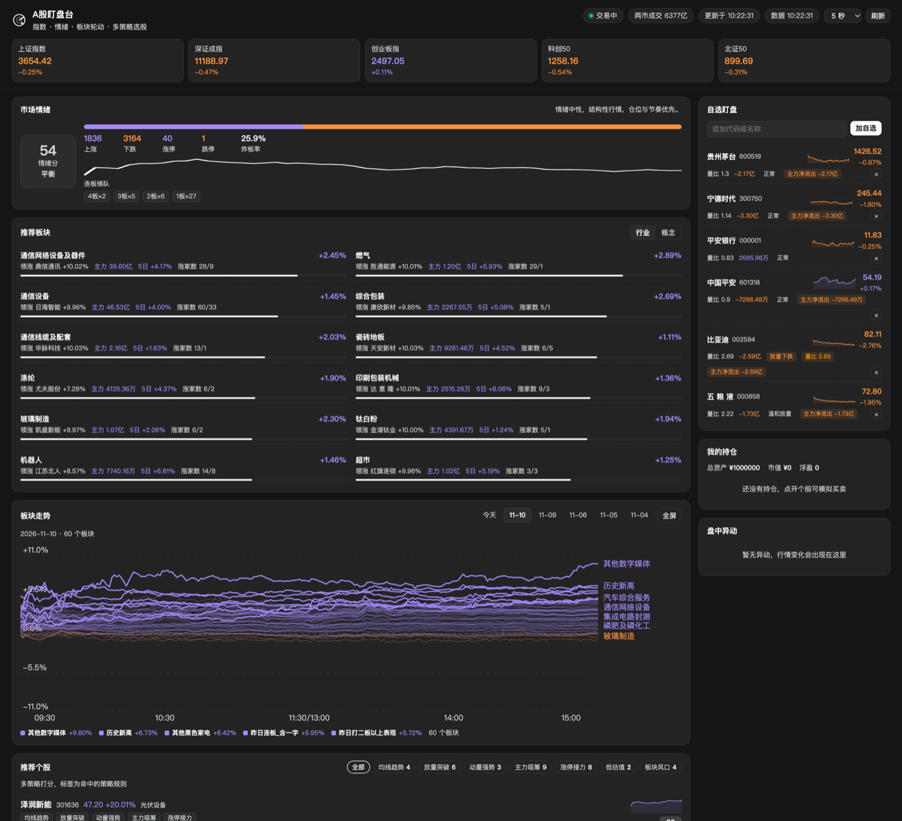
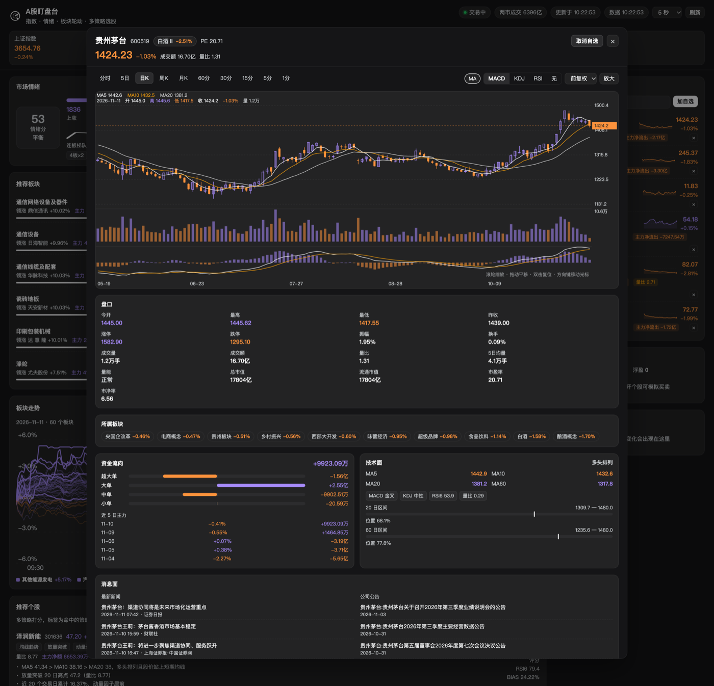

# A股盯盘台

一个 DeepSeek Harness 插件，把 Web UI 变成实时 A 股看盘台：侧栏一个入口打开整页面板，
包含指数条、涨跌家数、涨停梯队、板块轮动、多策略选股、自选盯盘和盘中异动。同一套引擎
也以 `ashare_radar` 工具的形式提供给 Agent。

[English](./README.md) · **简体中文**

**安装（一条命令）：**

```
plugin_manager  install_bundle  target=github:yg-y/ai-monitoring-stocks
```

也可以从 [Release](https://github.com/yg-y/ai-monitoring-stocks/releases) 下载 tgz，或按
[INSTALL.md](./INSTALL.md) 的另外两条路线。

## 截图



*指数条、市场情绪、板块轮动、自选盯盘与板块走势（前 50）——交易时段实拍。*



*个股详情：日K + 成交量 + MACD、盘口、所属板块、资金流向、技术面与消息面。*

## 面板内容

| 区块 | 内容 | 刷新 |
| --- | --- | --- |
| 指数条 | 上证 / 深成 / 创业板 / 科创50 / 北证50，点击任一指数看分时与 K 线 | 3–30 秒（可选） |
| 市场情绪 | 涨跌家数、涨停/跌停、炸板率、连板梯队、0–100 情绪分 | 5 秒 |
| 推荐板块 | 行业与概念板块按「涨幅 + 主力净流入 + 上涨宽度 + 5日动量」打分，点击进入成分股 | 20 秒 |
| 板块走势 | 前 50 个板块的当日涨跌幅曲线（09:30–15:00），末端标注板块名，可按天回看最近 30 天 | 60 秒 |
| 推荐个股 | 候选池 → 多策略打分 → 技术面复核，附命中标签与理由 | 45 秒 |
| 自选盯盘 | 实时价、涨跌幅、量比、主力净额、命中信号；支持代码或名称搜索 | 3–30 秒 |
| 我的持仓 | 模拟账户总资产、市值、浮动盈亏，点击持仓回到个股 | 随快照 |
| 盘中异动 | 涨停、逼近涨停、涨速、量比、主力异动、站上/跌破均线、20 日新高 | 随快照 |
| 个股详情 | 点自选或推荐标的打开：分时 / 5日 / 日K / 周K / 月K / 60–1 分 K，十字光标、缩放平移、MA + MACD/KDJ/RSI、复权切换、买卖模拟 | 交易时段 5 秒 |

## 个股详情页

点开个股（或指数）得到的是一页行情，而不只是一张图：

| 区块 | 内容 |
| --- | --- |
| 盘口 | 今开 / 最高 / 最低 / 昨收 / 涨停 / 跌停 / 振幅 / 换手率 / 成交量 / 成交额 / 量比 / 5日均量 / 总市值 / 流通市值 / 市盈率（亏损时显示"亏损"）/ 市净率 |
| 资金流向 | 主力净额 + 超大单 / 大单 / 中单 / 小单四档净额（居中双向条）、今日累计主力净流入曲线、近 5 日主力净额与当日涨跌 |
| 技术面 | MA5/10/20/60 与多空排列，MACD / KDJ / RSI 状态，20 日与 60 日区间位置 |
| 所属板块 | 行业标签（可点击进板块）+ 题材优先的所属板块标签，风格/指数类板块排在后面 |
| 消息面 | 最新新闻 8 条 + 公司公告 6 条，含时间与来源，点击标签打开原文 |
| AI 分析 | 用同一批数据做六维上涨空间推演（技术 / 量能 / 资金 / 板块情绪 / 消息 / 估值），每维 0-100 分 + 多空判断 + 理由与风险，并给出总评、置信度、支撑压力目标；支持多轮追问 |
| 图表 | 分时 / 5日 / 日K / 周K / 月K / 60–1 分 K，十字光标、缩放平移 |

数据来源：行情与 K 线来自东方财富，资金流来自其 `fflow`（今日分时累计 + 历史日线），
所属板块来自 `slist`，新闻与公告来自其搜索 / 公告接口；技术指标由日线 K 线本地计算
（MA / RSI / MACD / KDJ / 区间位置）。

## 性能与容错

- **K 线双数据源**：主源是东财历史主机，失败或返回空时自动切到腾讯公开 K 线接口
  （日 / 周 / 月 + 1/5/15/30/60 分钟，含前 / 后复权），技术指标随之恢复。
- **K 线落盘缓存**：成功响应存在 `<DSH_HOME>/ashare-radar/klines/`，两个数据源都不可用时
  回放最近一次数据，并在图表上方标注「显示最近一次缓存的 K 线」。
- **行情主机兜底**：主行情域 `push2` 被限流或掉线时自动切到 `push2delay`（延迟行情），
  并熔断 60 秒不再先试主域，避免每次请求都先失败一次。板块成分股、指数、自选、分时都走这条路径。
- **板块走势的取数深度**：库里已有前一交易日数据时只取 1 天（响应里的 `fetchDays: 1`），
  没有历史才回补 5 天——上游字节量降到 1/5。
- **K 线不再每 5 秒穿透缓存**：图表每 5 秒轮询，但 K 线只有缓存超过 30 秒才回源；
  未收盘那根由前端用最新价补齐。
- **走势图几何记忆化**：50 条 × 241 点 ≈ 12k 段路径只在数据变化时重建，鼠标移动只重画十字线。
- **走势卡片进入视口才请求**：首屏不再为主页下半部分付 50 次上游调用
  （`IntersectionObserver`，带 240px 预取）。
- **空板块明确提示**：统计类板块若无成分股，显示「该板块没有成分股数据（多为统计类板块）」
  而不是通用错误。

当前 30 天存储规模：60 个板块 × 5 个交易日 ≈ 790 KB，满 30 天约 4–5 MB。

## 板块走势

走势卡片画的是「板块相对昨收的涨跌幅曲线」：X 轴固定为交易时段（09:30–11:30、13:00–15:00），
Y 轴以 0 为中轴对称。

- 一次画**排名前 50 的板块**（行业 + 概念合并，按当日涨幅排序），领先的 8 个用粗线突出
- 曲线**末端直接标注板块名**，重叠的自动跳过（最多 12 个标签）
- **入场动画**：从 x=0 的 0 轴向右擦除到 X 轴尽头（`clipPath` 揭示，820ms）；
  进入卡片、切换日期、打开全屏时重放，轮询刷新不重放
- 线色按当日涨跌：**紫涨橙跌**，弱化为 0.3 透明度，避免 50 条线糊成一团

数据与存储：

- 数据来源：东财板块分时（`secid=90.BKxxxx`），一次调用取 5 个交易日，按前一日收盘逐日归一
- 存储：`<DSH_HOME>/ashare-radar/sectors/YYYY-MM-DD.json`，一天一个文件，**保留 30 天**，
  过期文件在每次写入时清理
- 每天最多保留 60 个板块（面板挑选的板块会轮换，文件不会无限膨胀）；已收盘且满 241 分钟的
  日子不再重写
- 打开当天数据时顺带补齐前 4 个交易日，所以第一次使用就有 5 天可回看
- 日期按钮只列有存档的日子，切换即读本地文件，不产生上游请求

## AI 分析

详情页底部是 **AI 分析** 面板。它把页面上的同一批数字——行情、成交、规模、均线、区间、
MACD/KDJ/RSI、量能、资金四档、所属板块、市场情绪、新闻与公告——压缩成简报，交给 Host 的
`llm` 服务，使用当前 profile 的默认模型。

- 六个维度：技术面 / 量能 / 资金面 / 板块与情绪 / 消息面 / 估值，各给 0-100 分与
  偏多 / 中性 / 偏空
- 系统提示要求：只引用简报里的数字，缺数据就说"数据不足"，不得编造财报与政策
- 输出为严格 JSON，由 Host 解析后下发（`done.parsed`），面板渲染成维度卡片
- 输出被 token 上限截断时，解析器退回最后一个完整结构，仍把已完成的维度渲染成卡片；
  完全无法解析才退回「原文」块并提示重试
- 支持追问（多轮），追问时重新注入最新数据，回答为纯文本
- 响应是 NDJSON 流（`delta` / `meta` / `error` / `done`），边生成边显示
- 该 POST 路由走主机的请求闸门：只有已登录的本机页面能调用，避免任意本地进程消耗模型额度

## 下钻

- **指数 → 图**：点指数条任意指数，打开与个股同款的分时 / 日K / 周K / 月K 图（指数不提供买卖）
- **板块 → 成分股**：点行业或概念板块，打开成分股列表，可按涨幅 / 主力 / 量比 / 换手 /
  涨速 / 市值排序，点任一成分股进入其行情图
- **个股 → 持仓**：成交后侧栏「我的持仓」即时出现，显示成本、现价与浮盈，点击回到个股

## 设计说明

经过一轮专业复盘的取舍：

- 轮询随交易时段自适应：交易时段按所选频率（默认 5 秒），休市自动降到 ≥30 秒，避免无意义请求
- 头部显示**行情时间**而不是后端耗时；指数用 secid 寻址，避免「上证指数 000001」与
  「平安银行 000001」撞码
- 价格统一两位小数，**紫涨橙跌**，数字使用等宽字形
- 推荐个股按**策略族**去重后再按评分填充，不会八只都是同一个动量规则；评分带口径说明
- 未持仓时「卖出」禁用；指数详情不出现交易面板

## 图表规范

详情图表遵循 A 股看盘软件的习惯：

- **周期**：分时、5 日分时、日 K、周 K、月 K、60/30/15/5/1 分钟
- **主图**：蜡烛（阳线空心、阴线实心）或分时折线；MA5/10/20 叠加可开关
- **副图**：成交量 + MACD / KDJ / RSI（可切换「无」）
- **分时**：以昨收为中心的对称价格轴、均价线、昨收虚线、涨停/跌停虚线
  （主板 10%、双创 20%、北交所 30%、ST 5%）
- **十字光标**：吸附最近一根，跟随鼠标给出 日期/开/高/低/收/涨跌幅/量，同时标注右侧价格与底部日期
- **交互**：滚轮缩放（以光标为锚点）、拖动平移、双击复位、方向键移动光标、
  `+`/`-` 缩放、`0` 复位
- **复权**：前复权 / 不复权 / 后复权
- **实时**：交易时段每 5 秒拉取一次；未收盘的那根随最新价更新高/低/收
- **放大**：弹窗内可一键展开到接近全屏
- **列表迷你分时**：自选、推荐、板块成分股每一行都带 24px 高的分时缩略线（紫涨橙跌、
  昨收虚线），并在 5 分钟内出现急拉/急跌时打上「急拉」「急跌」角标
  （阈值随涨跌幅限制缩放，且只认最近 40 分钟内的急拉段）

## 策略族

每只股票按下列规则打分，标签即命中的规则名。

| 标签 | 策略族 | 规则 |
| --- | --- | --- |
| 均线趋势 | 趋势跟随 | MA5 > MA10 > MA20 多头排列，价格站上 MA5，MA20 上翘 |
| 放量突破 | 量价形态 | 量比 ≥ 1.5 的阳线突破 20 日新高 |
| 动量强势 | 动量因子 | 近 20 日涨幅 ≥ 15% |
| 主力吸筹 | 资金流 | 主力净流入 / 成交额 ≥ 5% |
| 超跌反弹 | 均值回归 | 20 日乖离 ≤ -8% 且 RSI6 ≤ 34 |
| 涨停接力 | 情绪博弈 | 封板或逼近涨停（主板 9.6%，创业板/科创板 19.4%） |
| 低估值 | 价值 | PE ≤ 18、PB ≤ 2、市值 ≥ 100 亿，叠加趋势确认 |
| 板块风口 | 板块轮动 | 所属行业进入当日板块涨幅榜前列 |

评分是各规则权重的软上限求和：命中五条规则的标的会明显拉开命中两条的，而不是双双触及上限。

## 数据

公开、免密钥、只读的行情源：

- 东财行情 `push2.eastmoney.com` — 指数、个股、板块、K 线
- 东财涨停池 `push2ex.eastmoney.com` — 涨停 / 跌停 / 炸板、连板数、封单
- 雪球涨跌家数 `flash-api.xuangubao.cn` — 上涨/下跌/涨停家数曲线
- 腾讯 K 线 `web.ifzq.gtimg.cn` — 日/周/月与分钟线，仅作兜底

Host 半对每个源做缓存（行情 2.5 秒、板块 20 秒、K 线 4 分钟），上游报错时回退到最近一次
好值；失败的源会在面板里标注，而不是整块空白。

## Host 接口

与 Web UI 同源的只读 HTTP 路由：

- `GET /ashare-radar/api/snapshot?codes=600519,000001&mode=full|light&limit=8`
- `GET /ashare-radar/api/quote?codes=...`
- `GET /ashare-radar/api/sector?kind=industry|concept`
- `GET /ashare-radar/api/search?q=宁德`
- `GET /ashare-radar/api/detail?code=600519&period=trend|trend5|day|week|month|m60|m30|m15|m5|m1&adjust=0|1|2&fresh=0|1` — 分时（含涨跌停价）或 K 线，附快照
- `GET /ashare-radar/api/sector-trend?date=2026-11-10&codes=BK0459,BK1340` — 板块当日曲线（日切，含 30 天日期索引）
- `GET /ashare-radar/api/board?code=BK0459&sort=f3|f62|f10|f8|f22|f20&limit=50` — 板块成分股
- `GET /ashare-radar/api/flow?code=600519[&secid=1.000001]` — 今日分时资金流 + 近 5 日
- `GET /ashare-radar/api/news?code=600519&name=贵州茅台` — 个股新闻 + 公司公告
- `POST /ashare-radar/api/analyze` — AI 多维分析（NDJSON 流），body `{code,name,question?,history?}`
- `GET /ashare-radar/api/strategies`

Agent 工具 `ashare_radar`：

```
action: overview | quote | recommend | strategy | board | analyze
codes?: ["600519"]   limit?: 8
```

## 说明

- 交易时段以外仍显示最近一笔行情；市场状态（未开盘 / 集合竞价 / 交易中 / 午间休市 / 已收盘 /
  周末休市）按 Asia/Shanghai 计算
- 节假日没有内置日历：若上游无成交，页面显示最近收盘数据
- 自选、刷新频率与模拟账户存在浏览器 `localStorage`
  （`ashare-radar.watchlist.v1`、`ashare-radar.speed.v1`、`ashare-radar.account.v1`）
- **买卖是模拟盘**：按最新价在本地记账（初始 100 万，100 股一手），不接券商、不发真实委托
- 策略信号只描述规则命中，**不构成投资建议**

## 许可证

MIT —— 见 [LICENSE](./LICENSE)。行情数据来自东方财富、腾讯、雪球的公开接口，仅供个人研究
使用，不构成投资建议。
